# Ringkasan Audit & Desain Database Empathika (Final)

Dokumen ini berisi hasil audit menyeluruh dan spesifikasi final desain database Prisma (`backend/prisma/schema.prisma`) yang diselaraskan dengan seluruh fitur di frontend (`frontend/src`) dan backend (`backend/src`) untuk 4 portal web: **Client (Publik & Tamu)**, **Admin Utama**, **Admin-Biro**, dan **Psikolog**.

---

## 1. Ringkasan Eksekutif & Keputusan Arsitektur Utama

1. **Arsitektur Klien: Tetap Tamu (Guest-Only)**
   - Klien **TIDAK memiliki akun, username, maupun password**.
   - Enum `Role` di database dipertahankan hanya untuk staf internal: `ADMIN`, `BIRO`, dan `PSIKOLOG`.
   - Data pemesanan dan riwayat klien dikelola berbasis kode pemesanan/tiket tamu (*guest checkout*), sehingga tabel `Client` tidak memiliki relasi ke tabel login `Account`.

2. **Wajib Timestamp Standar (`createdAt` & `updatedAt`)**
   - Seluruh tabel operasional (`Transaksi`, `Event`, `Biro`, `PaketPsikotes`, `BookingKonsultasi`, `BookingEvent`, `BookingPsikotes`, `Layanan`, `Psikolog`, `JadwalSlot`, `ArtikelBlog`, dan `PengajuanKerjaSama`) **wajib memiliki kolom `createdAt DateTime @default(now())` dan `updatedAt DateTime @updatedAt`** untuk audit log, analitik keuangan, dan pengurutan data riwayat.

3. **Penyimpanan Keluhan Klien (`deskripsi_trauma`)**
   - Kolom `deskripsi_trauma` **dihapus dari tabel `Client`** dan **dipusatkan seutuhnya pada tabel `BookingKonsultasi`**. Hal ini mencegah keluhan lama tertimpa saat klien memesan sesi berikutnya dengan permasalahan yang berbeda.

4. **Peniadaan Catatan Konseling Psikolog**
   - Kolom `catatan_konseling` / `clinical_notes` **TIDAK dibuat di database**, karena antarmuka web psikolog saat ini hanya memuat agenda jadwal dan pengelolaan slot ketersediaan, bukan rekam medis.

5. **Penyempurnaan Jalur Pembayaran (Payment Gateway)**
   - Enum `MetodePembayaran` dibatasi hanya untuk: `TRANSFER_BANK`, `E_WALLET`, dan `QRIS` (tanpa kartu kredit).
   - Ditambahkan kolom `channel_pembayaran` untuk menyimpan kanal spesifik (contoh: `bca_va`, `mandiri_va`, `bni_va`, `gopay`, `ovo`, `dana`, `qris`).

6. **Kategori Layanan Konseling Baru**
   - Menambahkan jenis layanan nyata dari frontend ke dalam enum `KategoriLayanan`: `HIPNOTERAPI`, `HOME_VISIT`, dan `PEER_KONSELOR`.

7. **Slug URL untuk SEO**
   - Ditambahkan kolom `slug String @unique` pada model `Event` dan `PaketPsikotes` agar URL browser bersih dan ramah SEO (contoh: `/event/workshop-seft`, `/psikotes/tes/kepribadian`).

8. **Tabel Kemitraan B2B Baru**
   - Dibuatkan tabel baru `PengajuanKerjaSama` untuk menampung data formulir kemitraan instansi dari halaman `/kerja-sama` dan dashboard `/admin/kerja-sama`.

9. **Peniadaan Fitur Suka / Likes pada Artikel Blog**
   - Kolom `likes` / `jumlah_like` **TIDAK dibuat di database**, sehingga tabel `ArtikelBlog` hanya mencatat metadata konten, waktu baca, tanggal terbit, dan `jumlah_dilihat` (views).

10. **Peniadaan Estimasi Waktu pada Paket Psikotes**
   - Kolom `durasi_menit` **TIDAK diadakan di database**, pengerjaan tes psikotes bersifat fleksibel tanpa batasan waktu.

11. **Kelengkapan Profil Admin Utama (`Account`) untuk Footer & Google Maps**
   - Kolom `alamat String?` dan `link_maps String?` ditambahkan pada model `Account` (khusus akun `ADMIN` utama). Hal ini karena Admin Utama yang mengelola identitas platform Empathika, kontak footer (`email`, `no_telepon`, `alamat`), dan tautan navigasi Google Maps pada halaman beranda klien (*Kunjungi Kami*), bukan Admin Biro.

12. **Penyesuaian `BookingPsikotes` (Free Assessment & Nullable Transaksi)**
   - Kolom `status` pada tabel `BookingPsikotes` **dihapus**, karena status kelulusan/hasil tes dipusatkan pada `HasilTes`.
   - Kolom `id_transaksi` pada tabel `BookingPsikotes` dijadikan **nullable (`String?`)**, untuk memfasilitasi paket psikotes gratis yang tidak memerlukan proses pembayaran.

13. **Penyimpanan Total Pembayaran Transaksi (`total`)**
   - Kolom `total Decimal @db.Decimal(12, 2)` **resmi ditambahkan** ke tabel `Transaksi` untuk mencatat nominal final pembayaran (`subtotal + biaya_admin`). Hal ini penting untuk integritas snapshot finansial, sinkronisasi webhook Payment Gateway (Xendit `amount`), serta mempercepat agregasi pelaporan pendapatan admin tanpa kalkulasi runtime.

---

## 2. Diagram UML Database (Mermaid Class Diagram)

Berikut adalah diagram kelas UML database lengkap yang mencakup 21 tabel, atribut PK/FK, method bisnis, dan kardinalitas relasi:

```mermaid
classDiagram

    %% ========================================================
    %% 1. AUTENTIKASI, TENANT & KLIEN (TAMU)
    %% ========================================================
    class Account {
        +string id_PK
        +string nama
        +string email
        +string password
        +string role
        +string no_telepon
        +string foto
        +string alamat
        +string link_maps
        +boolean aktif
        +string id_biro_FK
        +dateTime createdAt
        +dateTime updatedAt
    }

    class Client {
        +string id_PK
        +string id_biro_FK
        +string nama
        +string email
        +string no_telepon
        +int usia
        +string jenis_kelamin
        +dateTime createdAt
        +dateTime updatedAt
        +lihatHasilTes()
        +lihatRiwayatBooking()
    }

    class Biro {
        +string id_PK
        +string nama_biro
        +string slug
        +string id_account_FK
        +string logoURI
        +string warna_tema
        +string alamat
        +string deskripsi
        +string no_telepon
        +string website_url
        +string status
        +dateTime createdAt
        +dateTime updatedAt
        +updateProfilBiro()
        +toggleStatus()
    }

    %% ========================================================
    %% 2. LAYANAN, TENAGA AHLI & JADWAL
    %% ========================================================
    class Layanan {
        +string id_PK
        +string nama
        +string kategori
        +string deskripsi
        +float harga_weekday
        +float harga_weekend
        +string banner_url
        +boolean aktif
        +dateTime createdAt
        +dateTime updatedAt
        +hitungHarga()
        +toggleAktif()
    }

    class Psikolog {
        +string id_PK
        +string id_account_FK
        +string id_spesialisasi_FK
        +string kategori
        +string nama_gelar
        +string no_str
        +string no_sipp
        +string pendidikan
        +string pengalaman_tahun
        +string quote
        +string instagram
        +string keahlian
        +string jenis_kelamin
        +string foto
        +string bio
        +string status
        +int jumlah_sesi
        +float tarif_per_jam
        +dateTime createdAt
        +dateTime updatedAt
        +updateJadwal()
        +lihatDaftarBooking()
        +hitungTotalEarning() float
    }

    class Jadwal_Slot {
        +string id_PK
        +string id_psikolog_FK
        +date tanggal
        +time jam_mulai
        +time jam_selesai
        +string metode
        +string lokasi_ruangan
        +string status
        +dateTime createdAt
        +dateTime updatedAt
        +tandaiSudahDibooking()
        +cekKetersediaan() boolean
        +isWeekend() boolean
        +tambahSlot()
        +hapusSlot()
    }

    class Spesialisasi {
        +string id_PK
        +string nama
        +getPsikologBySpesialisasi()
    }

    class Testimoni {
        +string id_PK
        +string id_psikolog_FK
        +string isi
        +boolean anonim
        +string nama_pemberi
        +dateTime createdAt
        +tambahTestimoni()
        +sembunyikanIdentitas()
    }

    %% ========================================================
    %% 3. TRANSAKSI & BOOKING KONSULTASI
    %% ========================================================
    class Transaksi {
        +string id_PK
        +string id_client_FK
        +string kode_transaksi
        +float subtotal
        +float biaya_admin
        +float total
        +string metode_pembayaran
        +string channel_pembayaran
        +string status_pembayaran
        +dateTime tanggal_bayar
        +string data_pembayaran
        +dateTime createdAt
        +dateTime updatedAt
        +buatInvoice()
        +verifikasiPembayaran() boolean
        +prosesRefund()
    }

    class Booking_Konsultasi {
        +string id_PK
        +string kode_pesanan
        +string id_client_FK
        +string id_layanan_FK
        +string id_jadwal_FK
        +string id_transaksi_FK
        +string metode
        +string link_meet
        +string deskripsi_trauma
        +string status
        +dateTime createdAt
        +dateTime updatedAt
        +cekJadwalTersedia() boolean
        +ajukanBooking()
        +approveBooking()
        +rejectBooking()
    }

    %% ========================================================
    %% 4. EVENT & WORKSHOP
    %% ========================================================
    class Event {
        +string id_PK
        +string judul
        +string subjudul
        +string slug
        +string jenis_event
        +string deskripsi
        +date tanggal
        +time jam_mulai
        +int durasi_menit
        +string lokasi
        +int kuota
        +float harga
        +string banner_url
        +string nama_pembicara
        +string status
        +dateTime createdAt
        +dateTime updatedAt
        +cekKuotaTersedia() boolean
        +tutupPendaftaran()
        +tambahEvent()
    }

    class Booking_Event {
        +string id_PK
        +string id_event_FK
        +string id_client_FK
        +string id_transaksi_FK
        +string kode_tiket
        +string nama_lengkap
        +string no_hp
        +string status
        +dateTime createdAt
        +dateTime updatedAt
        +daftarEvent()
        +batalkanPendaftaran()
    }

    %% ========================================================
    %% 5. PSIKOTES ONLINE
    %% ========================================================
    class Paket_Psikotes {
        +string id_PK
        +string judul
        +string slug
        +string jenis_akses
        +float harga
        +string bannerURL
        +boolean is_active
        +string deskripsi
        +dateTime createdAt
        +dateTime updatedAt
        +tampilkanDetail()
        +perluPembayaran()
        +tambahPaket()
    }

    class Soal_Psikotes {
        +string id_PK
        +string id_paket_FK
        +int urutan
        +string pertanyaan
        +tambahSoal()
        +ambilSoal()
        +tampilkanSoal()
    }

    class Pilihan_Jawaban {
        +string id_PK
        +string id_soal_FK
        +string label
        +string teks_jawaban
        +int bobot
        +ambilBobot()
    }

    class Jawaban_Psikotes {
        +string id_PK
        +string id_booking_FK
        +string id_soal_psikotes_FK
        +string id_pilihan_jawaban_FK
        +int skor
        +simpanJawaban()
    }

    class Interpretasi_Psikotes {
        +string id_PK
        +string id_paket_FK
        +int min_skor
        +int max_skor
        +string grade
        +string judul
        +string deskripsi
        +string makna
        +json tips
        +cocokanSkor()
    }

    class Hasil_Tes {
        +string id_PK
        +string id_booking_FK
        +string id_interpretasi_FK
        +int total_skor
        +string detail_skor
        +dateTime tanggal_selesai
        +dateTime createdAt
        +hitungTotalSkor()
        +simpanHasil()
        +tampilkanHasil()
    }

    class Booking_Psikotes {
        +string id_PK
        +string id_paket_FK
        +string id_transaksi_FK_nullable
        +string id_client_FK
        +dateTime createdAt
        +dateTime updatedAt
        +buatBooking()
        +mulaiTes()
        +selesaiTes()
    }

    %% ========================================================
    %% 6. BLOG & KEMITRAAN B2B
    %% ========================================================
    class Artikel_Blog {
        +string id_PK
        +string judul
        +string slug
        +string isi
        +string banner_url
        +int waktu_baca_menit
        +dateTime tanggal_terbit
        +int jumlah_dilihat
        +dateTime createdAt
        +dateTime updatedAt
        +publikasikan()
    }

    class Pengajuan_Kerja_Sama {
        +string id_PK
        +string nama_instansi
        +string nama_pic
        +string email
        +string no_telepon
        +string kategori
        +string tipe_formulir
        +string pesan
        +string jawaban_detail
        +string status
        +dateTime createdAt
        +dateTime updatedAt
        +ajukanKerjaSama()
        +updateStatus()
    }

    %% ========================================================
    %% RELASI & KARDINALITAS
    %% (1-ke-1: panah kedua ujung <--> ; 1-ke-Many: sisi 1 panah, sisi * garis biasa <--)
    %% ========================================================
    Account "1" <--> "1" Psikolog : profil
    Account "1" <-- "*" Biro : owner
    Biro "1" <-- "*" Client : client

    Client "1" <-- "*" Booking_Konsultasi : memesan
    Client "1" <-- "*" Booking_Event : mendaftar
    Client "1" <-- "*" Booking_Psikotes : tes
    Client "1" <-- "*" Transaksi : membayar

    Layanan "1" <-- "*" Booking_Konsultasi : layanan
    Event "1" <-- "*" Booking_Event : event

    Jadwal_Slot "1" <--> "1" Booking_Konsultasi : jadwal
    Transaksi "1" <--> "1" Booking_Konsultasi : invoice_konseling
    Transaksi "1" <--> "1" Booking_Event : invoice_event
    Transaksi "0..1" <--> "1" Booking_Psikotes : invoice_psikotes

    Psikolog "1" <-- "*" Jadwal_Slot : slot
    Psikolog "1" <-- "*" Testimoni : testimoni
    Spesialisasi "1" <-- "*" Psikolog : bidang

    Paket_Psikotes "1" <-- "*" Soal_Psikotes : butir_soal
    Paket_Psikotes "1" <-- "*" Interpretasi_Psikotes : skor
    Paket_Psikotes "1" <-- "*" Booking_Psikotes : paket

    Soal_Psikotes "1" <-- "*" Pilihan_Jawaban : opsi
    Soal_Psikotes "1" <-- "*" Jawaban_Psikotes : jawaban
    Pilihan_Jawaban "1" <-- "*" Jawaban_Psikotes : pilihan

    Booking_Psikotes "1" <-- "*" Jawaban_Psikotes : lembar_jawaban
    Booking_Psikotes "1" <--> "1" Hasil_Tes : hasil
    Interpretasi_Psikotes "1" <-- "*" Hasil_Tes : kategori_skor
```

---

## 3. Rincian Perubahan Database

### KATEGORI 1: PERLU DIUBAH
1. **Model `Transaksi`**:
   - Mempertahankan enum `MetodePembayaran`: `TRANSFER_BANK`, `E_WALLET`, `QRIS` (tanpa kartu kredit).
   - Menambahkan kolom `channel_pembayaran String?` (contoh: `bca_va`, `mandiri_va`, `gopay`, `dana`, `qris`).
2. **Model `Layanan`**:
   - Memperluas enum `KategoriLayanan` dengan: `HIPNOTERAPI`, `HOME_VISIT`, dan `PEER_KONSELOR`.
3. **Model `Event`**:
   - Menambahkan nilai `DRAFT` pada enum `StatusEvent`.
4. **Model `Psikolog`**:
   - Menambahkan kolom `keahlian String?` untuk menampung multi-topik keahlian (*Quarter Life Crisis*, relasi, keluarga, dll).

### KATEGORI 2: PERLU DITAMBAHKAN
1. **Tabel Baru `PengajuanKerjaSama`**:
   - `id`, `nama_instansi`, `nama_pic`, `email`, `no_telepon`, `kategori`, `tipe_formulir`, `pesan`, `jawaban_detail`, `status`, `createdAt`, `updatedAt`.
2. **Atribut Baru pada Tabel Eksisting**:
   - `Account`: `alamat String?`, `link_maps String?` (khusus profil Admin Utama pengelola platform).
   - `Transaksi`: `kode_transaksi String? @unique`, `total Decimal @db.Decimal(12, 2)`, `channel_pembayaran String?`, `createdAt`, `updatedAt`.
   - `Event`: `slug String @unique`, `subjudul String?`, `createdAt`, `updatedAt`.
   - `PaketPsikotes`: `slug String @unique`, `createdAt`, `updatedAt`.
   - `BookingKonsultasi`: `metode String ("ONLINE" | "OFFLINE")`, `link_meet String?`, `createdAt`, `updatedAt`.
   - `ArtikelBlog`: `banner_url String?`, `waktu_baca_menit Int @default(5)`, `createdAt`, `updatedAt`.
   - `BookingEvent`: `kode_tiket String @unique`, `status StatusBooking @default(PENDING)`, `createdAt`, `updatedAt`.
   - `Client`: `usia Int?`, `jenis_kelamin String?`, `createdAt`, `updatedAt`.
   - `Psikolog`: `kategori String`, `no_sipp String?`, `quote String?`, `instagram String?`, `jenis_kelamin String?`, `pendidikan String?`, `pengalaman_tahun String?`, `createdAt`, `updatedAt`.
   - `JadwalSlot`: `metode String ("ONLINE" | "OFFLINE")`, `lokasi_ruangan String?`, `createdAt`, `updatedAt`.
   - `Biro`: `deskripsi String? @db.Text`, `no_telepon String?`, `website_url String?`, `status` (`PENDING`), `createdAt`, `updatedAt`.
   - `InterpretasiPsikotes`: `makna String? @db.Text`, `tips Json?` (array objek: `[{title, desc}]`).
   - `HasilTes`: `detail_skor Json?`, `createdAt`.
   - `BookingPsikotes`: `id_transaksi String? (nullable untuk tes gratis)`, `createdAt`, `updatedAt`.
   - `Testimoni`: `createdAt`.

### KATEGORI 3: PERLU DIHAPUS / DIBERSIHKAN
1. **Kolom `aktif Boolean` pada `Biro`**: Dihapus, dipusatkan pada enum `status StatusBiro` (`ACTIVE, INACTIVE, SUSPENDED, PENDING`).
2. **Kolom `deskripsi_trauma` pada `Client`**: Dihapus dari tabel `Client`, disimpan seutuhnya per sesi di tabel `BookingKonsultasi`.
3. **Kolom `likes` pada `ArtikelBlog`**: Ditiadakan / tidak disimpan di database.
4. **Kolom `durasi_menit` pada `PaketPsikotes`**: Ditiadakan dari database, pengerjaan psikotes bersifat fleksibel tanpa batasan waktu.
5. **Kolom `status` pada `BookingPsikotes`**: Dihapus dari tabel `BookingPsikotes`, status hasil dipusatkan pada tabel `HasilTes`.
6. **Kolom `kategori` pada `PaketPsikotes`**: Dihapus dari tabel `PaketPsikotes`.
