# Ringkasan Audit & Desain Database Empathika (Final)

Dokumen ini berisi hasil audit menyeluruh dan spesifikasi final desain database Prisma (`backend/prisma/schema.prisma`) yang diselaraskan dengan seluruh fitur di frontend (`frontend/src`) dan backend (`backend/src`) untuk 4 portal web: **Client (Publik & Tamu)**, **Admin Utama**, **Admin-Biro**, dan **Psikolog**.

---

## 1. Ringkasan Eksekutif & Keputusan Arsitektur Utama

1. **Arsitektur Klien: Tetap Tamu (Guest-Only)**
   - Klien **TIDAK memiliki akun, username, maupun password**.
   - Enum `Role` di database dipertahankan hanya untuk staf internal: `ADMIN`, `BIRO`, dan `PSIKOLOG`.
   - Data pemesanan dan riwayat klien dikelola berbasis kode pemesanan/tiket tamu (*guest checkout*), sehingga tabel `Client` tidak memiliki relasi ke tabel login `Account`.

2. **Wajib Timestamp Standar (`createdAt` & `updatedAt`)**
   - Seluruh tabel operasional (`Transaksi`, `Event`, `Biro`, `PaketPsikotes`, `BookingKonsultasi`, `BookingEvent`, `BookingPsikotes`, `Layanan`, `Psikolog`, `JadwalSlot`, `ArtikelBlog`, dan `PengajuanKerjaSama`) **wajib memiliki kolom `createdAt DateTime @default(now())` dan `updatedAt DateTime @updatedAt`** untuk audit log, analitik keuangan, dan pengurutan data riwayat.

3. **Penyimpanan Keluhan Klien (`deskripsi_trauma`)**
   - Kolom `deskripsi_trauma` **dihapus dari tabel `Client`** dan **dipusatkan seutuhnya pada tabel `BookingKonsultasi`**. Hal ini mencegah keluhan lama tertimpa saat klien memesan sesi berikutnya dengan permasalahan yang berbeda.

4. **Peniadaan Catatan Konseling Psikolog**
   - Kolom `catatan_konseling` / `clinical_notes` **TIDAK dibuat di database**, karena antarmuka web psikolog saat ini hanya memuat agenda jadwal dan pengelolaan slot ketersediaan, bukan rekam medis.

5. **Penyempurnaan Jalur Pembayaran (Payment Gateway)**
   - Enum `MetodePembayaran` dibatasi hanya untuk: `TRANSFER_BANK`, `E_WALLET`, dan `QRIS` (tanpa kartu kredit).
   - Ditambahkan kolom `channel_pembayaran` untuk menyimpan kanal spesifik (contoh: `bca_va`, `mandiri_va`, `bni_va`, `gopay`, `ovo`, `dana`, `qris`).

6. **Kategori Layanan & Metode Pelaksanaan pada Layanan Admin**
   - Kolom `metode String @default("Online/Offline")` **ditambahkan pada model `Layanan`** untuk menyimpan metode pelaksanaan layanan (`Online`, `Offline`, atau `Online/Offline`) yang diinput oleh Admin pada form tambah/edit layanan dan ditampilkan pada tabel admin.
   - Enum `KategoriLayanan` diselaraskan agar sinkron 100% dengan 5 kategori layanan resmi platform Empathika (halaman `/layanan`): `PSIKOTES`, `KONSULTASI`, `PELATIHAN_PEER_HELPER`, `EVENT`, dan `ASESMEN`. (Adapun pada menu `/admin/layanan`, admin mengelola 3 kategori bertarif sesi: `KONSULTASI`, `PELATIHAN_PEER_HELPER`, dan `ASESMEN`, sedangkan `PSIKOTES` dan `EVENT` dikelola pada menu/tabel khususnya masing-masing). Jenis layanan seperti `Psikolog`, `Peer Konselor`, `Hipnoterapi`, dan `Home Visit` disimpan pada kolom `nama String` di bawah kategori `KONSULTASI`.

7. **Slug URL untuk SEO**
   - Ditambahkan kolom `slug String @unique` pada model `Event` dan `PaketPsikotes` agar URL browser bersih dan ramah SEO (contoh: `/event/workshop-seft`, `/psikotes/tes/kepribadian`).

8. **Tabel Kemitraan B2B Baru**
   - Dibuatkan tabel baru `PengajuanKerjaSama` untuk menampung data formulir kemitraan instansi dari halaman `/kerja-sama` dan dashboard `/admin/kerja-sama`.

9. **Peniadaan Fitur Suka (Likes) & View Counter pada Artikel Blog**
   - Kolom `likes` dan `jumlah_dilihat` **TIDAK dibuat di database**, sehingga tabel `ArtikelBlog` murni mencatat judul, slug, isi artikel, banner, penulis (`author`), kategori, waktu baca, dan tanggal terbit.

10. **Peniadaan Estimasi Waktu pada Paket Psikotes**
   - Kolom `durasi_menit` **TIDAK diadakan di database**, pengerjaan tes psikotes bersifat fleksibel tanpa batasan waktu.

11. **Kelengkapan Profil Admin Utama (`Account`) untuk Footer & Google Maps**
   - Kolom `alamat String?` dan `link_maps String?` ditambahkan pada model `Account` (khusus akun `ADMIN` utama). Hal ini karena Admin Utama yang mengelola identitas platform Empathika, kontak footer (`email`, `no_telepon`, `alamat`), dan tautan navigasi Google Maps pada halaman beranda klien (*Kunjungi Kami*), bukan Admin Biro.

12. **Penyesuaian `BookingPsikotes` (Free Assessment & Nullable Transaksi)**
   - Kolom `status` pada tabel `BookingPsikotes` **dihapus**, karena status kelulusan/hasil tes dipusatkan pada `HasilTes`.
   - Kolom `id_transaksi` pada tabel `BookingPsikotes` dijadikan **nullable (`String?`)**, untuk memfasilitasi paket psikotes gratis yang tidak memerlukan proses pembayaran.

13. **Penyimpanan Total Pembayaran Transaksi (`total`)**
   - Kolom `total Decimal @db.Decimal(12, 2)` **resmi ditambahkan** ke tabel `Transaksi` untuk mencatat nominal final pembayaran (`subtotal + biaya_admin`). Hal ini penting untuk integritas snapshot finansial, sinkronisasi webhook Payment Gateway (Xendit `amount`), serta mempercepat agregasi pelaporan pendapatan admin tanpa kalkulasi runtime.

14. **Pembeda Tipe Jadwal pada `JadwalSlot` (`tipe_jadwal`)**
   - Kolom `tipe_jadwal String ("KONSULTASI" | "ASESMEN")` **ditambahkan** pada tabel `JadwalSlot`. Hal ini membedakan slot jadwal yang dibuka mandiri oleh Psikolog untuk sesi konsultasi (`KONSULTASI`) dengan slot jadwal yang diatur oleh Admin Utama untuk layanan asesmen Empathika (`ASESMEN`), sekaligus mencegah bentrok jam kerja psikolog yang sama.

15. **Pemesanan Sesi Mandiri oleh Admin & Penyesuaian `BookingKonsultasi` (`id_transaksi` Nullable)**
   - Pada dashboard jadwal admin (`/admin/jadwal` dan modal *Sesi Baru* `ModalTambahSesi`), Admin Utama dan Admin Biro dapat menjadwalkan sesi konsultasi/asesmen secara langsung ke kalender operasional (misalnya untuk pendaftaran klien *walk-in* langsung ke klinik, pemesanan via telepon/WhatsApp, atau sesi darurat).
   - Sesi mandiri admin ini tidak melalui alur *checkout payment gateway* online Xendit. Agar tidak terjadi kegagalan *foreign key constraint*, kolom `id_transaksi` pada tabel `BookingKonsultasi` **diubah menjadi nullable (`String? @unique`)** (sejalan dengan `BookingPsikotes` pada tes gratis). Relasi transaksi ke booking konsultasi menjadi opsional (`Transaksi 0..1 ke 1 BookingKonsultasi`).

16. **Dukungan Operasional WhatsApp & Kontak Klien pada Jadwal Sesi Hari Ini**
   - Halaman pemantauan sesi harian admin dilengkapi tombol aksi cepat *Chat WA Klien* dan *Salin Pesan WA* untuk sesi aktif (`Segera Dimulai` dan `Menunggu Jadwal`). Fitur ini mengandalkan nomor kontak klien (`Client.no_telepon`) untuk menghasilkan pesan konfirmasi WhatsApp terstruktur otomatis lengkap dengan ID Klien, Layanan, Psikolog, Jam Sesi, dan Metode Pertemuan.
   - Form input modal *Sesi Baru* di admin mewajibkan/menyediakan input `no_telepon` agar kontak klien selalu tersimpan di tabel `Client`.

17. **Siklus Status Booking Operasional Admin & Peniadaan `link_meet` di Database**
   - Pada tabel `BookingKonsultasi`, kolom `metode ("ONLINE" | "OFFLINE")` mencatat format pertemuan yang dipilih (Online atau Offline di Klinik).
   - Kolom `link_meet` **TIDAK diadakan di database**, karena link pertemuan Zoom / Google Meet dibuat mandiri oleh Admin secara eksternal (di luar sistem web) dan dibagikan langsung oleh admin kepada klien (misalnya melalui chat WhatsApp menjelang sesi).
   - Catatan keluhan awal yang diinput admin saat membuat sesi baru disimpan pada kolom `deskripsi_trauma`.
   - Admin memiliki wewenang aksi langsung untuk mengubah status sesi menjadi Selesai (`COMPLETED`) atau membatalkan sesi (`CANCELLED`), yang dipetakan pada enum `StatusBooking` (`PENDING`, `CONFIRMED`, `COMPLETED`, `CANCELLED`).

18. **Penyimpanan Skor pada Lembar Jawaban Psikotes (`JawabanPsikotes.skor`)**
   - Kolom `skor Int` **resmi ditambahkan pada tabel `JawabanPsikotes`** untuk menyimpan snapshot nilai bobot dari opsi jawaban yang dipilih klien pada butir soal terkait saat tes dikerjakan. Hal ini memastikan integritas data (skor jawaban klien tidak berubah jika bobot master soal diedit di masa depan) serta mempercepat agregasi `total_skor` dan analisis per butir/dimensi tes tanpa query join berulang ke tabel `PilihanJawaban`.

19. **Slug URL pada Program Kerja Sama (`ProgramKerjaSama.slug`)**
   - Kolom `slug String @unique` **tetap wajib ada** pada model `ProgramKerjaSama` (Program Kolaborasi) untuk routing URL halaman program di sisi klien (`/kerja-sama/[category]`, seperti `/kerja-sama/mahasiswa`, `/kerja-sama/perusahaan`). Adapun tabel formulir pesan masuk instansi (`PengajuanKerjaSama`) murni mencatat data permohonan/leads (nama PIC, instansi, kontak WA) tanpa halaman publik sendiri.

20. **Pola Filter Multi-Dimensi pada Jadwal & Sesi Operasional Admin**
   - Pemfilteran "Semua Layanan" dan "Tanggal" pada kalender operasional admin (`/admin/jadwal`) sepenuhnya memanfaatkan relasi relasional yang sudah ada (`BookingKonsultasi.id_layanan` -> `Layanan` dan `BookingKonsultasi.id_jadwal` -> `JadwalSlot.tanggal`). Tidak diperlukan kolom redundan/denormalisasi tambahan pada skema database.

21. **Alur Pemesanan Khusus Layanan Asesmen (Guest Checkout Tanpa Pemilihan Psikolog)**
   - Berbeda dengan sesi konsultasi di mana klien memilih profil psikolog terlebih dahulu, alur pemesanan Asesmen di sisi klien (`/asesmen` dan `/booking/asesmen`) menyajikan **tabel daftar harga paket asesmen terstandar** (Minat Bakat, Kesiapan Sekolah, dll.) dengan kolom Weekday dan Weekend tanpa menampilkan daftar psikolog.
   - Klien memilih paket dan menekan tombol *Daftar Sesi* yang langsung mengarahkan ke kalender penjadwalan (`/konseling/jadwal?layanan=asesmen`). Klien hanya memilih tanggal dan jam dari slot asesmen yang tersedia.

22. **Pengaturan Jadwal Asesmen via Kalender Admin (`/admin/jadwal`) & Penugasan Psikolog/Asesor Internal**
   - Ketersediaan slot tanggal dan jam asesmen **sepenuhnya ditentukan dan dibuka oleh Admin Utama** melalui kalender pada menu *Sesi dan Jadwal* (`/admin/jadwal`) dengan penanda `JadwalSlot.tipe_jadwal = "ASESMEN"`.
   - Penugasan psikolog/asesor pelaksana dilakukan **secara internal oleh Admin**:
     - Saat Admin membuka slot asesmen di kalender, Admin mengaitkan psikolog/asesor yang bertugas (`JadwalSlot.id_psikolog`), atau
     - Menetapkan psikolog dari tim penilai internal klinik Empathika saat booking masuk (`BookingKonsultasi`).
   - Dengan skema ini, relasi database `BookingKonsultasi -> JadwalSlot -> Psikolog` tetap valid dan konsisten, tanpa membebani klien untuk memilih profil psikolog.

23. **Standardisasi State URL SearchParams Lintas Modul Admin (Pusat & Biro)**
   - Penerapan arsitektur *deep-linking* berbasis query parameters URL (`useSearchParams` + `router.replace`) pada seluruh modul operasional:
     - Admin Layanan: `?category=...&q=...`
     - Admin Jadwal & Sesi: `?layanan=...&status=...&date=...`
     - Admin Ringkasan Operasional (Utama & Biro): `?period=...&modal=...`
     - Admin Kerja Sama: `?tab=...`
   - Memastikan state filter, pencarian, dan modal tersimpan di URL sehingga dapat di-*bookmark*, di-refresh tanpa kehilangan konteks, dan kompatibel dengan riwayat tombol Back/Forward browser.

24. **Model Tabel `ProgramKerjaSama` untuk Katalog Kolaborasi Instansi**
   - Dibuatkan tabel mandiri `ProgramKerjaSama` untuk menyimpan data program kolaborasi B2B yang dikelola melalui menu `/admin/kerja-sama` (tab *Pilihan Kolaborasi Web Client*, tombol *+ Tambah Program*, aksi edit/hapus/toggle status) serta ditampilkan di halaman publik `/kerja-sama` dan routing dinamis `/kerja-sama/[category]`.
   - Menyimpan judul program, short name, deskripsi, informasi modul pelatihan (*pelatihanTitle*, *pelatihanDeskripsi*, *pelatihanImage*), informasi mitra instansi (*mitraTitle*, *mitraDeskripsi*, *mitraImage*), warna tema, urutan display, dan status aktif/disembunyikan.

25. **Atribut Media & Profil Mendalam Psikolog (`video_intro_url`, `video_thumbnail`, `profil_lengkap`)**
   - Kolom `video_intro_url String?`, `video_thumbnail String?`, dan `profil_lengkap String? @db.Text` ditambahkan pada model `Psikolog`.
   - Data ini diinput oleh staf/psikolog melalui form pengaturan profil (`/admin/profile` atau `/psikolog-web/profile`) dan ditampilkan di halaman publik detail psikolog (`/psikolog/[id]`) untuk memfasilitasi fitur video greeting/sapaan psikolog serta narasi biografi lengkap sebelum klien memesan sesi.

26. **Fleksibilitas Konfigurasi Pertanyaan Formulir Kemitraan Dinamis**
   - Pada menu `/admin/kerja-sama` (tab *Kelola Formulir*), Admin Utama memiliki wewenang untuk menambah, mengubah, atau menghapus butir pertanyaan formulir untuk 4 tipe kemitraan (*Asesmen*, *In-House Training*, *Affiliate*, dan *Lainnya*).
   - Jawaban dinamis dari perwakilan instansi yang mengisi formulir publik (`/kerja-sama/formulir/[type]`) disimpan secara terstruktur dan fleksibel pada kolom `PengajuanKerjaSama.jawaban_detail Json?` tanpa memerlukan alter skema tabel setiap kali pertanyaan diperbarui.

27. **Fleksibilitas Kategori `PELATIHAN_PEER_HELPER` & Alur Pemesanan**
   - Kategori `PELATIHAN_PEER_HELPER` resmi menjadi salah satu pilar layanan bertarif sesi yang ditampung dalam tabel `Layanan`.
   - Mengingat variasi topik pelatihannya bersifat berkembang dan dinamis (contoh produk yang ada: *Pelatihan Konselor Sebaya Dasar*), jenis-jenis pelatihan **tidak dipecah menjadi enum sub-kategori kaku**, melainkan diinput sebagai master layanan baru melalui form `/admin/layanan/tambah?category=03`.
   - Pemesanan sesi pelatihan perorangan/kelompok terdaftar terhubung ke relasi `BookingKonsultasi -> Layanan`, sedangkan pengajuan pelatihan massal berskala instansi/organisasi disalurkan melalui `PengajuanKerjaSama`.

---

## 2. Diagram UML Database (Mermaid Class Diagram)

Berikut adalah diagram kelas UML database lengkap yang mencakup 22 tabel, atribut PK/FK, method bisnis, dan kardinalitas relasi:

```mermaid
classDiagram

    %% ========================================================
    %% 1. AUTENTIKASI, TENANT & KLIEN (TAMU)
    %% ========================================================
    class Account {
        +string id_PK
        +string nama
        +string email
        +string password
        +string role
        +string no_telepon
        +string foto
        +string alamat
        +string link_maps
        +boolean aktif
        +string id_biro_FK
        +dateTime createdAt
        +dateTime updatedAt
        +login() boolean
        +logout()
        +updateProfil()
        +gantiPassword()
    }

    class Client {
        +string id_PK
        +string id_biro_FK
        +string nama
        +string email
        +string no_telepon
        +int usia
        +string jenis_kelamin
        +dateTime createdAt
        +dateTime updatedAt
        +lihatHasilTes()
        +lihatRiwayatBooking()
    }

    class Biro {
        +string id_PK
        +string nama_biro
        +string slug
        +string id_account_FK
        +string logoURI
        +string warna_tema
        +string alamat
        +string deskripsi
        +string no_telepon
        +string website_url
        +string status
        +dateTime createdAt
        +dateTime updatedAt
        +updateProfilBiro()
        +toggleStatus()
    }

    %% ========================================================
    %% 2. LAYANAN, TENAGA AHLI & JADWAL
    %% ========================================================
    class Layanan {
        +string id_PK
        +string nama
        +string kategori
        +string metode
        +string deskripsi
        +float harga_weekday
        +float harga_weekend
        +string banner_url
        +boolean aktif
        +dateTime createdAt
        +dateTime updatedAt
        +hitungHarga() float
        +tambahLayanan()
        +updateLayanan()
        +toggleAktif()
    }

    class Psikolog {
        +string id_PK
        +string id_account_FK
        +string id_spesialisasi_FK
        +string kategori
        +string nama_gelar
        +string no_str
        +string no_sipp
        +string pendidikan
        +string pengalaman_tahun
        +string quote
        +string instagram
        +string keahlian
        +string jenis_kelamin
        +string foto
        +string bio
        +string video_intro_url
        +string video_thumbnail
        +string profil_lengkap
        +string status
        +int jumlah_sesi
        +float tarif_per_jam
        +dateTime createdAt
        +dateTime updatedAt
        +updateJadwal()
        +lihatDaftarBooking()
        +hitungTotalEarning() float
    }

    class Jadwal_Slot {
        +string id_PK
        +string id_psikolog_FK
        +string tipe_jadwal
        +date tanggal
        +time jam_mulai
        +time jam_selesai
        +string status
        +dateTime createdAt
        +dateTime updatedAt
        +tandaiSudahDibooking()
        +cekKetersediaan() boolean
        +isWeekend() boolean
        +tambahSlot()
        +hapusSlot()
    }

    class Spesialisasi {
        +string id_PK
        +string nama
        +getPsikologBySpesialisasi()
    }

    class Testimoni {
        +string id_PK
        +string id_psikolog_FK
        +string isi
        +boolean anonim
        +string nama_pemberi
        +dateTime createdAt
        +tambahTestimoni()
        +sembunyikanIdentitas()
    }

    %% ========================================================
    %% 3. TRANSAKSI & BOOKING KONSULTASI
    %% ========================================================
    class Transaksi {
        +string id_PK
        +string id_client_FK
        +string kode_transaksi
        +float subtotal
        +float biaya_admin
        +float total
        +string metode_pembayaran
        +string channel_pembayaran
        +string status_pembayaran
        +dateTime tanggal_bayar
        +string data_pembayaran
        +dateTime createdAt
        +dateTime updatedAt
        +buatInvoice()
        +verifikasiPembayaran() boolean
        +prosesRefund()
    }

    class Booking_Konsultasi {
        +string id_PK
        +string kode_pesanan
        +string id_client_FK
        +string id_layanan_FK
        +string id_jadwal_FK
        +string id_transaksi_FK_nullable
        +string metode
        +string deskripsi_trauma
        +string status
        +dateTime createdAt
        +dateTime updatedAt
        +cekJadwalTersedia() boolean
        +ajukanBooking()
        +approveBooking()
        +rejectBooking()
        +tandaiSelesai()
        +batalkanSesi()
        +kirimPengingatWA()
    }

    %% ========================================================
    %% 4. EVENT & WORKSHOP
    %% ========================================================
    class Event {
        +string id_PK
        +string judul
        +string subjudul
        +string slug
        +string jenis_event
        +string deskripsi
        +date tanggal
        +time jam_mulai
        +int durasi_menit
        +string lokasi
        +int kuota
        +float harga
        +string banner_url
        +string nama_pembicara
        +string status
        +dateTime createdAt
        +dateTime updatedAt
        +cekKuotaTersedia() boolean
        +tutupPendaftaran()
        +tambahEvent()
    }

    class Booking_Event {
        +string id_PK
        +string id_event_FK
        +string id_client_FK
        +string id_transaksi_FK
        +string kode_tiket
        +string nama_lengkap
        +string no_hp
        +string status
        +dateTime createdAt
        +dateTime updatedAt
        +daftarEvent()
        +batalkanPendaftaran()
    }

    %% ========================================================
    %% 5. PSIKOTES ONLINE
    %% ========================================================
    class Paket_Psikotes {
        +string id_PK
        +string judul
        +string slug
        +string jenis_akses
        +float harga
        +string banner_url
        +boolean is_active
        +string deskripsi
        +dateTime createdAt
        +dateTime updatedAt
        +tampilkanDetail()
        +perluPembayaran()
        +tambahPaket()
    }

    class Soal_Psikotes {
        +string id_PK
        +string id_paket_FK
        +int urutan
        +string pertanyaan
        +tambahSoal()
        +ambilSoal()
        +tampilkanSoal()
    }

    class Pilihan_Jawaban {
        +string id_PK
        +string id_soal_FK
        +string label
        +string teks_jawaban
        +int bobot
        +ambilBobot() int
        +updatePilihan()
    }

    class Jawaban_Psikotes {
        +string id_PK
        +string id_booking_FK
        +string id_soal_psikotes_FK
        +string id_pilihan_jawaban_FK
        +int skor
        +simpanJawaban()
    }

    class Interpretasi_Psikotes {
        +string id_PK
        +string id_paket_FK
        +int min_skor
        +int max_skor
        +string grade
        +string judul
        +string deskripsi
        +string makna
        +json tips
        +cocokanSkor()
    }

    class Hasil_Tes {
        +string id_PK
        +string id_booking_FK
        +string id_interpretasi_FK
        +int total_skor
        +json detail_skor
        +dateTime tanggal_selesai
        +dateTime createdAt
        +hitungTotalSkor()
        +simpanHasil()
        +tampilkanHasil()
    }

    class Booking_Psikotes {
        +string id_PK
        +string id_paket_FK
        +string id_transaksi_FK_nullable
        +string id_client_FK
        +dateTime createdAt
        +dateTime updatedAt
        +buatBooking()
        +mulaiTes()
        +selesaiTes()
    }

    %% ========================================================
    %% 6. BLOG & KEMITRAAN B2B
    %% ========================================================
    class Artikel_Blog {
        +string id_PK
        +string judul
        +string slug
        +string isi
        +string banner_url
        +string penulis
        +string kategori
        +int waktu_baca_menit
        +dateTime tanggal_terbit
        +dateTime createdAt
        +dateTime updatedAt
        +publikasikan()
    }

    class Pengajuan_Kerja_Sama {
        +string id_PK
        +string nama_instansi
        +string nama_pic
        +string email
        +string no_telepon
        +string kategori
        +string tipe_formulir
        +string pesan
        +string jawaban_detail
        +string status
        +dateTime createdAt
        +dateTime updatedAt
        +ajukanKerjaSama()
        +updateStatus()
    }

    class Program_Kerja_Sama {
        +string id_PK
        +string slug
        +string title
        +string short_name
        +string deskripsi
        +string pelatihan_title
        +string pelatihan_deskripsi
        +string pelatihan_image
        +string mitra_title
        +string mitra_deskripsi
        +string mitra_image
        +string warna_tema
        +string status
        +int urutan
        +dateTime createdAt
        +dateTime updatedAt
        +tambahProgram()
        +updateProgram()
        +toggleStatus()
    }

    %% ========================================================
    %% RELASI & KARDINALITAS
    %% (1-ke-1: panah kedua ujung <--> ; 1-ke-Many: sisi 1 panah, sisi * garis biasa <--)
    %% ========================================================
    Account "1" <--> "1" Psikolog : profil
    Account "1" <-- "*" Biro : owner
    Biro "1" <-- "*" Client : client

    Client "1" <-- "*" Booking_Konsultasi : memesan
    Client "1" <-- "*" Booking_Event : mendaftar
    Client "1" <-- "*" Booking_Psikotes : tes
    Client "1" <-- "*" Transaksi : membayar

    Layanan "1" <-- "*" Booking_Konsultasi : layanan
    Event "1" <-- "*" Booking_Event : event

    Jadwal_Slot "1" <--> "1" Booking_Konsultasi : jadwal
    Transaksi "0..1" <--> "1" Booking_Konsultasi : invoice_konseling
    Transaksi "1" <--> "1" Booking_Event : invoice_event
    Transaksi "0..1" <--> "1" Booking_Psikotes : invoice_psikotes

    Psikolog "1" <-- "*" Jadwal_Slot : slot
    Psikolog "1" <-- "*" Testimoni : testimoni
    Spesialisasi "1" <-- "*" Psikolog : bidang

    Paket_Psikotes "1" <-- "*" Soal_Psikotes : butir_soal
    Paket_Psikotes "1" <-- "*" Interpretasi_Psikotes : skor
    Paket_Psikotes "1" <-- "*" Booking_Psikotes : paket

    Soal_Psikotes "1" <-- "*" Pilihan_Jawaban : opsi
    Soal_Psikotes "1" <-- "*" Jawaban_Psikotes : jawaban
    Pilihan_Jawaban "1" <-- "*" Jawaban_Psikotes : pilihan

    Booking_Psikotes "1" <-- "*" Jawaban_Psikotes : lembar_jawaban
    Booking_Psikotes "1" <--> "1" Hasil_Tes : hasil
    Interpretasi_Psikotes "1" <-- "*" Hasil_Tes : kategori_skor
```

---

## 3. Rincian Perubahan Database

### KATEGORI 1: PERLU DIUBAH
1. **Model `Transaksi`**:
   - Mempertahankan enum `MetodePembayaran`: `TRANSFER_BANK`, `E_WALLET`, `QRIS` (tanpa kartu kredit).
   - Menambahkan kolom `channel_pembayaran String?` (contoh: `bca_va`, `mandiri_va`, `gopay`, `dana`, `qris`).
2. **Model `Layanan`**:
   - Menambahkan kolom `metode String @default("Online/Offline")` untuk mencatat metode pelaksanaan layanan (`Online`, `Offline`, atau `Online/Offline`) yang dipilih admin di form input dan ditampilkan di tabel `/admin/layanan`.
   - Menyelaraskan enum `KategoriLayanan` dengan 5 kategori layanan platform Empathika: `PSIKOTES`, `KONSULTASI`, `PELATIHAN_PEER_HELPER`, `EVENT`, dan `ASESMEN`. Adapun jenis layanan seperti `Psikolog`, `Peer Konselor`, `Hipnoterapi`, dan `Home Visit` disimpan pada kolom `nama String` di bawah kategori `KONSULTASI`.
3. **Model `Event`**:
   - Menambahkan nilai `DRAFT` pada enum `StatusEvent`.
4. **Model `Psikolog`**:
   - Menambahkan kolom `keahlian String?` untuk menampung multi-topik keahlian (*Quarter Life Crisis*, relasi, keluarga, dll).
5. **Model `BookingKonsultasi`**:
   - Mengubah kolom `id_transaksi` menjadi **nullable (`String? @unique`)** agar Admin Utama / Biro dapat menjadwalkan sesi klien baru secara mandiri via modal *Sesi Baru* (`ModalTambahSesi`) atau klien *walk-in* klinik tanpa transaksi payment gateway online.
   - Memastikan `status StatusBooking` mendukung siklus operasional admin (`PENDING`, `CONFIRMED`, `COMPLETED`, `CANCELLED`).

### KATEGORI 2: PERLU DITAMBAHKAN
1. **Tabel Baru `PengajuanKerjaSama` & `ProgramKerjaSama`**:
   - `PengajuanKerjaSama`: `id`, `nama_instansi`, `nama_pic`, `email`, `no_telepon`, `kategori`, `tipe_formulir`, `pesan`, `jawaban_detail` (Json), `status`, `createdAt`, `updatedAt`.
   - `ProgramKerjaSama`: `id`, `slug`, `title`, `short_name`, `deskripsi`, `pelatihan_title`, `pelatihan_deskripsi`, `pelatihan_image`, `mitra_title`, `mitra_deskripsi`, `mitra_image`, `warna_tema`, `status` ("AKTIF" | "NONAKTIF"), `urutan`, `createdAt`, `updatedAt`.
2. **Atribut Baru pada Tabel Eksisting**:
   - `Account`: `alamat String?`, `link_maps String?` (khusus profil Admin Utama pengelola platform).
   - `Transaksi`: `kode_transaksi String? @unique`, `total Decimal @db.Decimal(12, 2)`, `channel_pembayaran String?`, `createdAt`, `updatedAt`.
   - `Event`: `slug String @unique`, `subjudul String?`, `createdAt`, `updatedAt`.
   - `PaketPsikotes`: `slug String @unique`, `banner_url String?`, `createdAt`, `updatedAt`.
   - `Layanan`: `metode String @default("Online/Offline")`, `createdAt`, `updatedAt`.
   - `BookingKonsultasi`: `id_transaksi String? (nullable untuk sesi mandiri admin / walk-in)`, `metode String ("ONLINE" | "OFFLINE")`, `deskripsi_trauma String?` (menampung keluhan awal konsultasi maupun catatan pengajuan asesmen terstandar tanpa pemilihan psikolog oleh klien), `createdAt`, `updatedAt`.
   - `ArtikelBlog`: `banner_url String?`, `penulis String @default("Admin Empathika")`, `kategori String? @default("Artikel")`, `waktu_baca_menit Int @default(5)`, `createdAt`, `updatedAt`.
   - `BookingEvent`: `kode_tiket String @unique`, `status StatusBooking @default(PENDING)`, `createdAt`, `updatedAt`.
   - `Client`: `no_telepon String?` (data vital operasional admin untuk integrasi tombol *Chat WA Klien* dan *Salin Pesan WA* pada pemantauan sesi klien harian), `usia Int?`, `jenis_kelamin String?`, `createdAt`, `updatedAt`.
   - `Psikolog`: `kategori String`, `no_sipp String?`, `quote String?`, `instagram String?`, `jenis_kelamin String?`, `pendidikan String?`, `pengalaman_tahun String?`, `video_intro_url String?`, `video_thumbnail String?`, `profil_lengkap String? @db.Text`, `createdAt`, `updatedAt`.
   - `JadwalSlot`: `tipe_jadwal String ("KONSULTASI" | "ASESMEN")` (membedakan slot konsultasi mandiri psikolog dengan slot asesmen yang dibuka & ditugaskan psikolog/asesornya secara internal oleh Admin melalui kalender `/admin/jadwal`), `createdAt`, `updatedAt`.
   - `Biro`: `deskripsi String? @db.Text`, `no_telepon String?`, `website_url String?`, `status` (`PENDING`), `createdAt`, `updatedAt`.
   - `InterpretasiPsikotes`: `makna String? @db.Text`, `tips Json?` (array objek: `[{title, desc}]`).
   - `HasilTes`: `detail_skor Json?`, `createdAt`.
   - `BookingPsikotes`: `id_transaksi String? (nullable untuk tes gratis)`, `createdAt`, `updatedAt`.
   - `JawabanPsikotes`: `skor Int` (snapshot nilai bobot opsi jawaban yang dipilih klien pada butir soal).
   - `Testimoni`: `createdAt`.

### KATEGORI 3: PERLU DIHAPUS / DIBERSIHKAN
1. **Kolom `aktif Boolean` pada `Biro`**: Dihapus, dipusatkan pada enum `status StatusBiro` (`ACTIVE, INACTIVE, SUSPENDED, PENDING`).
2. **Kolom `deskripsi_trauma` pada `Client`**: Dihapus dari tabel `Client`, disimpan seutuhnya per sesi di tabel `BookingKonsultasi`.
3. **Kolom `likes` dan `jumlah_dilihat` pada `ArtikelBlog`**: Ditiadakan / tidak disimpan di database.
4. **Kolom `durasi_menit` pada `PaketPsikotes`**: Ditiadakan dari database, pengerjaan psikotes bersifat fleksibel tanpa batasan waktu.
5. **Kolom `status` pada `BookingPsikotes`**: Dihapus dari tabel `BookingPsikotes`, status hasil dipusatkan pada tabel `HasilTes`.
6. **Kolom `kategori` pada `PaketPsikotes`**: Dihapus dari tabel `PaketPsikotes`.
7. **Kolom `lokasi_ruangan` & `metode` pada `JadwalSlot`**: Ditiadakan dari database. `lokasi_ruangan` ditiadakan karena sesi offline langsung datang ke kantor fisik Empathika, sedangkan `metode` ("ONLINE" | "OFFLINE") dipusatkan pada tabel `BookingKonsultasi` karena ditentukan oleh pilihan klien saat pemesanan.
8. **Kolom `link_meet` pada `BookingKonsultasi`**: Ditiadakan dari database, karena tautan meeting Zoom / Google Meet dibuat mandiri oleh admin secara eksternal di luar aplikasi web dan dikirimkan langsung ke klien via WhatsApp.

